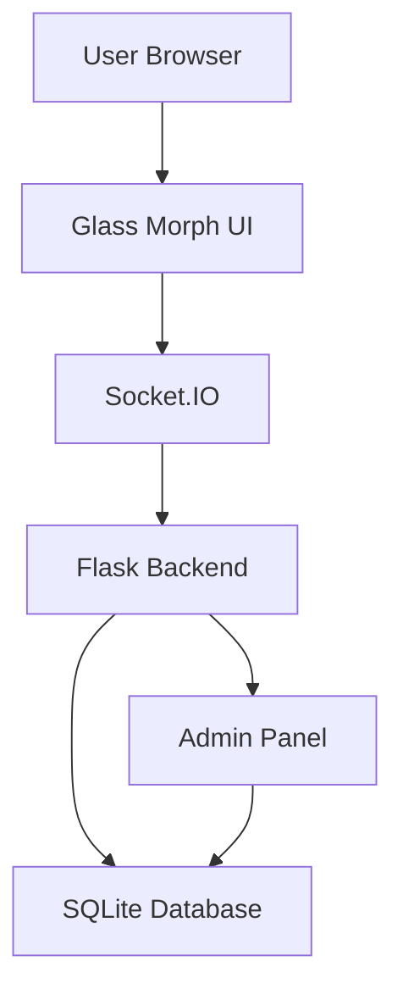
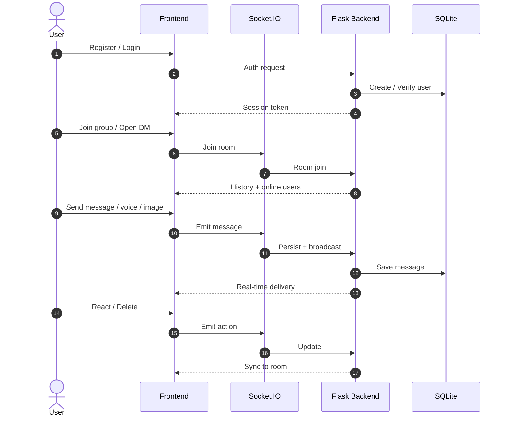

**𝐄𝐗𝐔 𝐂𝐇𝐀𝐓**

<p align="center">
  
  
  
  
</p>

<p align="center"><b>𝐅𝐮𝐥𝐥-𝐅𝐞𝐚𝐭𝐮𝐫𝐞𝐝 𝐑𝐞𝐚𝐥-𝐓𝐢𝐦𝐞 𝐂𝐡𝐚𝐭 𝐏𝐥𝐚𝐭𝐟𝐨𝐫𝐦</b></p>

<p align="center"><b>𝐑𝐞𝐠𝐢𝐬𝐭𝐞𝐫 → 𝐅𝐫𝐢𝐞𝐧𝐝𝐬 & 𝐆𝐫𝐨𝐮𝐩𝐬 → 𝐌𝐞𝐬𝐬𝐚𝐠𝐞 → 𝐕𝐨𝐢𝐜𝐞 & 𝐈𝐦𝐚𝐠𝐞 → 𝐑𝐞𝐚𝐜𝐭 → 𝐀𝐝𝐦𝐢𝐧</b></p>

<p align="center">
  𝐁𝐮𝐢𝐥𝐭 𝐟𝐨𝐫 <b>𝐃𝐞𝐬𝐤𝐭𝐨𝐩</b> 𝐚𝐧𝐝 <b>𝐌𝐨𝐛𝐢𝐥𝐞 𝐁𝐫𝐨𝐰𝐬𝐞𝐫𝐬</b><br>
  𝐂𝐨𝐦𝐩𝐥𝐞𝐭𝐞𝐥𝐲 𝐬𝐞𝐥𝐟-𝐜𝐨𝐧𝐭𝐚𝐢𝐧𝐞𝐝 𝐠𝐥𝐚𝐬𝐬-𝐦𝐨𝐫𝐩𝐡𝐢𝐬𝐦 𝐔𝐈 𝐰𝐢𝐭𝐡 𝐧𝐞𝐨𝐧 𝐚𝐞𝐬𝐭𝐡𝐞𝐭𝐢𝐜.
</p>

---

## **📖 𝐎𝐯𝐞𝐫𝐯𝐢𝐞𝐰**

**𝐄𝐗𝐔 𝐂𝐇𝐀𝐓** 𝐢𝐬 𝐚 𝐬𝐞𝐥𝐟-𝐜𝐨𝐧𝐭𝐚𝐢𝐧𝐞𝐝, 𝐫𝐞𝐚𝐥-𝐭𝐢𝐦𝐞 𝐜𝐡𝐚𝐭 𝐞𝐧𝐠𝐢𝐧𝐞 𝐛𝐮𝐢𝐥𝐭 𝐰𝐢𝐭𝐡 𝐅𝐥𝐚𝐬𝐤 + 𝐒𝐨𝐜𝐤𝐞𝐭.𝐈𝐎.

𝐈𝐭 𝐬𝐮𝐩𝐩𝐨𝐫𝐭𝐬 𝐮𝐬𝐞𝐫 𝐫𝐞𝐠𝐢𝐬𝐭𝐫𝐚𝐭𝐢𝐨𝐧, 𝐟𝐫𝐢𝐞𝐧𝐝 𝐫𝐞𝐪𝐮𝐞𝐬𝐭𝐬, 𝐩𝐫𝐢𝐯𝐚𝐭𝐞 𝐃𝐌𝐬, 𝐠𝐫𝐨𝐮𝐩 𝐜𝐡𝐚𝐭𝐬, 𝐯𝐨𝐢𝐜𝐞 𝐦𝐞𝐬𝐬𝐚𝐠𝐞𝐬, 𝐢𝐦𝐚𝐠𝐞 𝐬𝐡𝐚𝐫𝐢𝐧𝐠, 𝐞𝐦𝐨𝐣𝐢 𝐫𝐞𝐚𝐜𝐭𝐢𝐨𝐧𝐬, 𝐥𝐢𝐧𝐤 𝐩𝐫𝐞𝐯𝐢𝐞𝐰𝐬, 𝐨𝐧𝐥𝐢𝐧𝐞 𝐬𝐭𝐚𝐭𝐮𝐬, 𝐚𝐧𝐝 𝐚 𝐟𝐮𝐥𝐥 𝐚𝐝𝐦𝐢𝐧 𝐝𝐚𝐬𝐡𝐛𝐨𝐚𝐫𝐝.

𝐓𝐡𝐞 𝐢𝐧𝐭𝐞𝐫𝐟𝐚𝐜𝐞 𝐟𝐞𝐚𝐭𝐮𝐫𝐞𝐬 𝐚 𝐝𝐚𝐫𝐤 𝐠𝐥𝐚𝐬𝐬-𝐦𝐨𝐫𝐩𝐡𝐢𝐬𝐦 𝐝𝐞𝐬𝐢𝐠𝐧 𝐰𝐢𝐭𝐡 𝐧𝐞𝐨𝐧 𝐠𝐫𝐚𝐝𝐢𝐞𝐧𝐭𝐬 𝐭𝐡𝐚𝐭 𝐥𝐨𝐨𝐤𝐬 𝐬𝐭𝐮𝐧𝐧𝐢𝐧𝐠 𝐨𝐧 𝐛𝐨𝐭𝐡 𝐝𝐞𝐬𝐤𝐭𝐨𝐩 𝐚𝐧𝐝 𝐦𝐨𝐛𝐢𝐥𝐞 𝐛𝐫𝐨𝐰𝐬𝐞𝐫𝐬.

---

## **✨ 𝐂𝐨𝐫𝐞 𝐅𝐞𝐚𝐭𝐮𝐫𝐞𝐬**

| 𝐅𝐞𝐚𝐭𝐮𝐫𝐞 | 𝐃𝐞𝐬𝐜𝐫𝐢𝐩𝐭𝐢𝐨𝐧 |
|---------|-------------|
| 💬 **𝐑𝐞𝐚𝐥-𝐓𝐢𝐦𝐞 𝐌𝐞𝐬𝐬𝐚𝐠𝐢𝐧𝐠** | 𝐈𝐧𝐬𝐭𝐚𝐧𝐭 𝐦𝐞𝐬𝐬𝐚𝐠𝐞 𝐝𝐞𝐥𝐢𝐯𝐞𝐫𝐲 𝐯𝐢𝐚 𝐖𝐞𝐛𝐒𝐨𝐜𝐤𝐞𝐭 (𝐒𝐨𝐜𝐤𝐞𝐭.𝐈𝐎) |
| 👥 **𝐅𝐫𝐢𝐞𝐧𝐝𝐬 & 𝐃𝐌𝐬** | 𝐒𝐞𝐧𝐝 / 𝐚𝐜𝐜𝐞𝐩𝐭 𝐟𝐫𝐢𝐞𝐧𝐝 𝐫𝐞𝐪𝐮𝐞𝐬𝐭𝐬 𝐚𝐧𝐝 𝐩𝐫𝐢𝐯𝐚𝐭𝐞 𝐜𝐡𝐚𝐭𝐬 |
| 🏠 **𝐆𝐫𝐨𝐮𝐩 𝐂𝐡𝐚𝐭𝐬** | 𝐂𝐫𝐞𝐚𝐭𝐞 𝐩𝐮𝐛𝐥𝐢𝐜 𝐨𝐫 𝐩𝐫𝐢𝐯𝐚𝐭𝐞 𝐠𝐫𝐨𝐮𝐩𝐬 𝐰𝐢𝐭𝐡 𝐦𝐞𝐦𝐛𝐞𝐫 𝐜𝐨𝐧𝐭𝐫𝐨𝐥 |
| 🎙️ **𝐕𝐨𝐢𝐜𝐞 𝐌𝐞𝐬𝐬𝐚𝐠𝐞𝐬** | 𝐑𝐞𝐜𝐨𝐫𝐝 𝐚𝐧𝐝 𝐬𝐞𝐧𝐝 𝐚𝐮𝐝𝐢𝐨 𝐦𝐞𝐬𝐬𝐚𝐠𝐞𝐬 𝐰𝐢𝐭𝐡 𝐰𝐚𝐯𝐞𝐟𝐨𝐫𝐦 |
| 🖼️ **𝐈𝐦𝐚𝐠𝐞 𝐒𝐡𝐚𝐫𝐢𝐧𝐠** | 𝐔𝐩𝐥𝐨𝐚𝐝 𝐚𝐧𝐝 𝐯𝐢𝐞𝐰 𝐢𝐦𝐚𝐠𝐞𝐬 𝐢𝐧𝐬𝐢𝐝𝐞 𝐜𝐡𝐚𝐭 |
| ❤️ **𝐄𝐦𝐨𝐣𝐢 𝐑𝐞𝐚𝐜𝐭𝐢𝐨𝐧𝐬** | 𝐑𝐞𝐚𝐜𝐭 𝐭𝐨 𝐚𝐧𝐲 𝐦𝐞𝐬𝐬𝐚𝐠𝐞 𝐰𝐢𝐭𝐡 𝐞𝐦𝐨𝐣𝐢𝐬 |
| 🔗 **𝐋𝐢𝐧𝐤 𝐏𝐫𝐞𝐯𝐢𝐞𝐰𝐬** | 𝐀𝐮𝐭𝐨𝐦𝐚𝐭𝐢𝐜 𝐫𝐢𝐜𝐡 𝐩𝐫𝐞𝐯𝐢𝐞𝐰𝐬 𝐟𝐨𝐫 𝐬𝐡𝐚𝐫𝐞𝐝 𝐥𝐢𝐧𝐤𝐬 |
| ✅ **𝐕𝐞𝐫𝐢𝐟𝐢𝐞𝐝 𝐔𝐬𝐞𝐫𝐬** | 𝐀𝐝𝐦𝐢𝐧 𝐜𝐚𝐧 𝐦𝐚𝐫𝐤 𝐮𝐬𝐞𝐫𝐬 𝐚𝐬 𝐯𝐞𝐫𝐢𝐟𝐢𝐞𝐝 |
| 🛡️ **𝐀𝐝𝐦𝐢𝐧 𝐃𝐚𝐬𝐡𝐛𝐨𝐚𝐫𝐝** | 𝐅𝐮𝐥𝐥 𝐮𝐬𝐞𝐫 / 𝐠𝐫𝐨𝐮𝐩 / 𝐛𝐚𝐧 𝐦𝐚𝐧𝐚𝐠𝐞𝐦𝐞𝐧𝐭 𝐩𝐚𝐧𝐞𝐥 |
| 🎨 **𝐆𝐥𝐚𝐬𝐬 𝐌𝐨𝐫𝐩𝐡𝐢𝐬𝐦 𝐔𝐈** | 𝐍𝐞𝐨𝐧 𝐠𝐫𝐚𝐝𝐢𝐞𝐧𝐭𝐬 + 𝐛𝐥𝐮𝐫 𝐠𝐥𝐚𝐬𝐬 𝐞𝐟𝐟𝐞𝐜𝐭 𝐨𝐩𝐭𝐢𝐦𝐢𝐳𝐞𝐝 𝐟𝐨𝐫 𝐦𝐨𝐛𝐢𝐥𝐞 |

---

## **🏗️ 𝐒𝐲𝐬𝐭𝐞𝐦 𝐀𝐫𝐜𝐡𝐢𝐭𝐞𝐜𝐭𝐮𝐫𝐞**



---

## **🔄 𝐂𝐡𝐚𝐭 𝐋𝐢𝐟𝐞𝐜𝐲𝐜𝐥𝐞**



---

## **📱 𝐐𝐮𝐢𝐜𝐤 𝐒𝐭𝐚𝐫𝐭**

### 𝟏. 𝐂𝐥𝐨𝐧𝐞 & 𝐈𝐧𝐬𝐭𝐚𝐥𝐥

```bash
git clone https://github.com/exu-coder-9x/FF-PV-MASG.git
cd FF-PV-MASG
pip install -r requirements.txt
```

### 𝟐. 𝐑𝐮𝐧

```bash
python main.py
```

𝐎𝐩𝐞𝐧 𝐢𝐧 𝐲𝐨𝐮𝐫 𝐛𝐫𝐨𝐰𝐬𝐞𝐫:

```
http://localhost:8080
```

𝐀𝐝𝐦𝐢𝐧 𝐩𝐚𝐧𝐞𝐥:

```
http://localhost:8080/admin
```

---

## **⚙️ 𝐂𝐨𝐧𝐟𝐢𝐠𝐮𝐫𝐚𝐭𝐢𝐨𝐧**

𝐄𝐝𝐢𝐭 𝐭𝐡𝐞 𝐭𝐨𝐩 𝐨𝐟 `main.py`:

| 𝐊𝐞𝐲 | 𝐏𝐮𝐫𝐩𝐨𝐬𝐞 | 𝐃𝐞𝐟𝐚𝐮𝐥𝐭 |
|-----|---------|---------|
| `ADMIN_PASS` | 𝐀𝐝𝐦𝐢𝐧 𝐥𝐨𝐠𝐢𝐧 𝐩𝐚𝐬𝐬𝐰𝐨𝐫𝐝 | `"npm run dev"` |
| `SITE_NAME` | 𝐒𝐢𝐭𝐞 𝐭𝐢𝐭𝐥𝐞 | `"EXU CHAT"` |
| `GROUP_NAME` | 𝐃𝐞𝐟𝐚𝐮𝐥𝐭 𝐠𝐫𝐨𝐮𝐩 𝐧𝐚𝐦𝐞 | `"Main Group"` |
| 𝐏𝐨𝐫𝐭 | 𝐒𝐞𝐫𝐯𝐞𝐫 𝐩𝐨𝐫𝐭 | `8080` |

𝐏𝐥𝐚𝐜𝐞 𝐲𝐨𝐮𝐫 𝐨𝐰𝐧 𝐢𝐦𝐚𝐠𝐞𝐬 𝐧𝐞𝐱𝐭 𝐭𝐨 `main.py`:

- `group.png` / `group.jpg` → 𝐃𝐞𝐟𝐚𝐮𝐥𝐭 𝐠𝐫𝐨𝐮𝐩 𝐚𝐯𝐚𝐭𝐚𝐫  
- `group_bg.png` → 𝐂𝐡𝐚𝐭 𝐛𝐚𝐜𝐤𝐠𝐫𝐨𝐮𝐧𝐝  
- `favicon.png`, `apple-touch-icon.png` → 𝐈𝐜𝐨𝐧𝐬  

---

## **🛠️ 𝐓𝐞𝐜𝐡𝐧𝐨𝐥𝐨𝐠𝐲 𝐒𝐭𝐚𝐜𝐤**

| 𝐋𝐚𝐲𝐞𝐫 | 𝐓𝐞𝐜𝐡𝐧𝐨𝐥𝐨𝐠𝐲 |
|-------|------------|
| **𝐅𝐫𝐨𝐧𝐭𝐞𝐧𝐝** | 𝐕𝐚𝐧𝐢𝐥𝐥𝐚 𝐉𝐒 + 𝐆𝐥𝐚𝐬𝐬-𝐌𝐨𝐫𝐩𝐡𝐢𝐬𝐦 𝐂𝐒𝐒 |
| **𝐁𝐚𝐜𝐤𝐞𝐧𝐝** | 𝐅𝐥𝐚𝐬𝐤 𝟑 + 𝐅𝐥𝐚𝐬𝐤-𝐒𝐨𝐜𝐤𝐞𝐭𝐈𝐎 |
| **𝐑𝐞𝐚𝐥-𝐓𝐢𝐦𝐞** | 𝐖𝐞𝐛𝐒𝐨𝐜𝐤𝐞𝐭 (𝐒𝐨𝐜𝐤𝐞𝐭.𝐈𝐎) |
| **𝐃𝐚𝐭𝐚𝐛𝐚𝐬𝐞** | 𝐒𝐐𝐋𝐢𝐭𝐞 (𝐖𝐀𝐋 𝐦𝐨𝐝𝐞) |
| **𝐀𝐮𝐭𝐡** | 𝐒𝐞𝐬𝐬𝐢𝐨𝐧 𝐭𝐨𝐤𝐞𝐧𝐬 + 𝐩𝐚𝐬𝐬𝐰𝐨𝐫𝐝 𝐡𝐚𝐬𝐡𝐢𝐧𝐠 |
| **𝐌𝐞𝐝𝐢𝐚** | 𝐕𝐨𝐢𝐜𝐞 𝐫𝐞𝐜𝐨𝐫𝐝𝐢𝐧𝐠 + 𝐈𝐦𝐚𝐠𝐞 𝐮𝐩𝐥𝐨𝐚𝐝 |
| **𝐃𝐞𝐩𝐥𝐨𝐲𝐦𝐞𝐧𝐭** | 𝐒𝐢𝐧𝐠𝐥𝐞-𝐟𝐢𝐥𝐞 𝐏𝐲𝐭𝐡𝐨𝐧 𝐬𝐞𝐫𝐯𝐞𝐫 |

---

## **📌 𝐃𝐞𝐬𝐢𝐠𝐧 𝐏𝐡𝐢𝐥𝐨𝐬𝐨𝐩𝐡𝐲**

𝐄𝐗𝐔 𝐂𝐇𝐀𝐓 𝐢𝐬 𝐛𝐮𝐢𝐥𝐭 𝐚𝐫𝐨𝐮𝐧𝐝 𝐭𝐡𝐫𝐞𝐞 𝐩𝐫𝐢𝐧𝐜𝐢𝐩𝐥𝐞𝐬:

- **𝐌𝐨𝐛𝐢𝐥𝐞-𝐟𝐢𝐫𝐬𝐭** — 𝐏𝐞𝐫𝐟𝐞𝐜𝐭𝐥𝐲 𝐮𝐬𝐚𝐛𝐥𝐞 𝐨𝐧 𝐩𝐡𝐨𝐧𝐞 𝐛𝐫𝐨𝐰𝐬𝐞𝐫𝐬 𝐰𝐢𝐭𝐡 𝐬𝐚𝐟𝐞-𝐚𝐫𝐞𝐚 𝐬𝐮𝐩𝐩𝐨𝐫𝐭  
- **𝐙𝐞𝐫𝐨 𝐝𝐞𝐩𝐞𝐧𝐝𝐞𝐧𝐜𝐢𝐞𝐬 𝐨𝐧 𝐭𝐡𝐞 𝐟𝐫𝐨𝐧𝐭𝐞𝐧𝐝** — 𝐍𝐨 𝐑𝐞𝐚𝐜𝐭 / 𝐕𝐮𝐞 / 𝐛𝐮𝐧𝐝𝐥𝐞𝐫 𝐫𝐞𝐪𝐮𝐢𝐫𝐞𝐝  
- **𝐒𝐞𝐥𝐟-𝐜𝐨𝐧𝐭𝐚𝐢𝐧𝐞𝐝** — 𝐎𝐧𝐞 𝐏𝐲𝐭𝐡𝐨𝐧 𝐟𝐢𝐥𝐞 + 𝐒𝐐𝐋𝐢𝐭𝐞 = 𝐟𝐮𝐥𝐥 𝐜𝐡𝐚𝐭 𝐩𝐥𝐚𝐭𝐟𝐨𝐫𝐦  

---

## **⚠️ 𝐃𝐢𝐬𝐜𝐥𝐚𝐢𝐦𝐞𝐫**

**𝐅𝐨𝐫 𝐞𝐝𝐮𝐜𝐚𝐭𝐢𝐨𝐧𝐚𝐥 𝐚𝐧𝐝 𝐩𝐞𝐫𝐬𝐨𝐧𝐚𝐥 𝐮𝐬𝐞 𝐨𝐧𝐥𝐲.**

𝐘𝐨𝐮 𝐚𝐫𝐞 𝐬𝐨𝐥𝐞𝐥𝐲 𝐫𝐞𝐬𝐩𝐨𝐧𝐬𝐢𝐛𝐥𝐞 𝐟𝐨𝐫 𝐡𝐨𝐰 𝐲𝐨𝐮 𝐝𝐞𝐩𝐥𝐨𝐲 𝐚𝐧𝐝 𝐮𝐬𝐞 𝐭𝐡𝐢𝐬 𝐬𝐨𝐟𝐭𝐰𝐚𝐫𝐞.  
𝐂𝐡𝐚𝐧𝐠𝐞 𝐭𝐡𝐞 𝐝𝐞𝐟𝐚𝐮𝐥𝐭 𝐚𝐝𝐦𝐢𝐧 𝐩𝐚𝐬𝐬𝐰𝐨𝐫𝐝 𝐛𝐞𝐟𝐨𝐫𝐞 𝐞𝐱𝐩𝐨𝐬𝐢𝐧𝐠 𝐭𝐡𝐞 𝐬𝐞𝐫𝐯𝐞𝐫 𝐭𝐨 𝐭𝐡𝐞 𝐢𝐧𝐭𝐞𝐫𝐧𝐞𝐭.

---

## **📜 𝐋𝐢𝐜𝐞𝐧𝐬𝐞**

**𝐌𝐈𝐓 𝐋𝐢𝐜𝐞𝐧𝐬𝐞**

𝐓𝐡𝐢𝐬 𝐩𝐫𝐨𝐣𝐞𝐜𝐭 𝐢𝐬 𝐚 𝐟𝐮𝐥𝐥-𝐟𝐞𝐚𝐭𝐮𝐫𝐞𝐝, 𝐬𝐞𝐥𝐟-𝐡𝐨𝐬𝐭𝐞𝐝 𝐫𝐞𝐚𝐥-𝐭𝐢𝐦𝐞 𝐜𝐡𝐚𝐭 𝐬𝐲𝐬𝐭𝐞𝐦 𝐟𝐨𝐜𝐮𝐬𝐞𝐝 𝐨𝐧 𝐛𝐞𝐚𝐮𝐭𝐢𝐟𝐮𝐥 𝐔𝐈 𝐚𝐧𝐝 𝐳𝐞𝐫𝐨 𝐞𝐱𝐭𝐞𝐫𝐧𝐚𝐥 𝐬𝐞𝐫𝐯𝐢𝐜𝐞𝐬.

---

<p align="center">
  <b>𝐄𝐗𝐔 𝐂𝐇𝐀𝐓</b><br>
  𝐑𝐞𝐠𝐢𝐬𝐭𝐞𝐫 → 𝐂𝐨𝐧𝐧𝐞𝐜𝐭 → 𝐂𝐡𝐚𝐭 → 𝐑𝐞𝐚𝐜𝐭 → 𝐀𝐝𝐦𝐢𝐧
</p>
```
